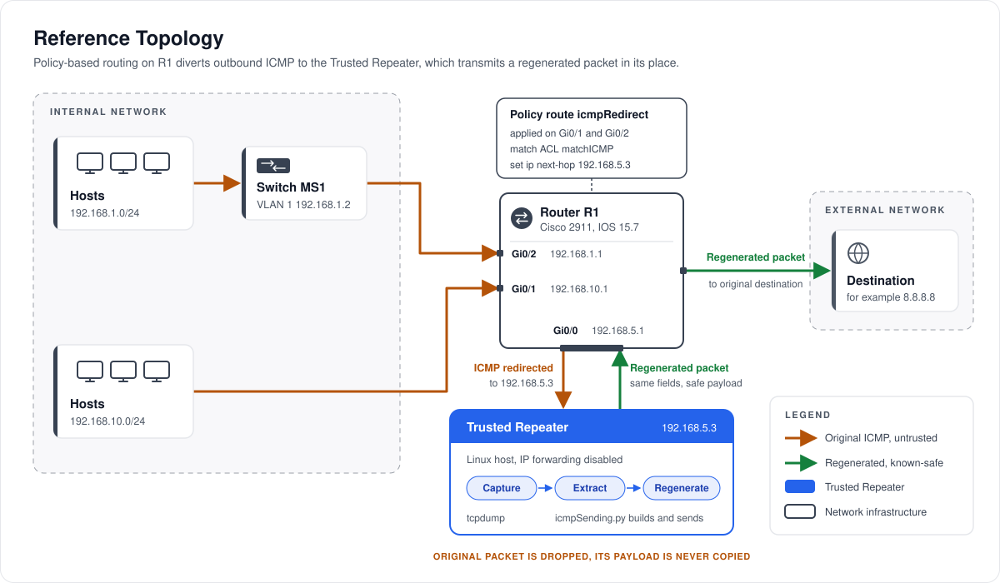

<p align="center"></p>

# Trusted Repeater

**Stops covert data exfiltration by regenerating outbound packets with known-safe payloads instead of inspecting them.**

 [](https://patents.google.com/patent/US12598158B2/)    

Trusted Repeater is the reference implementation of the packet regeneration method protected by U.S. Patent No. 12,598,158 B2. Outbound traffic is redirected to a trusted repeater, which extracts the control information, identifies the packet type, and emits a freshly generated packet with identical control fields and a known-safe payload. Any covert payload in the original is destroyed by construction, without having to detect it first.

## Overview

Data exfiltration hides in the payload of traffic that networks must allow. Trusted Repeater removes that hiding place: the original packet never leaves the network, and the packet that does leave is built from scratch by a trusted host that copies only the fields the protocol needs. This repository implements the method for ICMP echo traffic, using Cisco policy-based routing for the redirect, tcpdump for capture, and Python with Scapy for regeneration.

- **Redirect at the edge:** a policy route on router R1 sends outbound ICMP from the internal subnets to the repeater at `192.168.5.3`.
- **Extract and classify:** `icmpSending.py` reads the source, destination, echo type, identifier, and sequence number of each captured packet.
- **Regenerate, never forward:** a brand-new echo request or echo reply is built with the same control fields and the standard 56-byte ping payload.
- **Destroyed by construction:** the original payload is never read into the new packet, so tunneled data cannot survive, whatever its encoding.

## Business Case

### The Problem

Most breaches end the same way: data leaves through a channel the network was configured to allow. Firewalls permit ICMP for diagnostics, DNS for every application, and web traffic for the business, and attackers use those exact protocols to carry stolen data out. The result is regulatory exposure, breach notification and incident response costs, and the loss of intellectual property or customer trust that cannot be recovered.

- **ICMP tunneling:** off-the-shelf tunneling tools wrap files or an interactive shell inside the payload of ordinary ping packets. To a firewall that allows ICMP, the traffic looks like a host checking connectivity.
- **DNS tunneling:** malware encodes data into query names sent to an attacker-controlled domain and receives commands in the responses. DNS is rarely blocked because every service depends on it.
- **Malware beaconing after a phishing compromise:** an employee opens a phishing attachment, and the implant checks in on a timer, receives instructions, and leaks data in small slices hidden in allowed protocols. The attacker is already inside, so perimeter blocking has nothing left to stop.

Detection-based defenses must recognize each channel before they can stop it. New or custom-encoded tunnels evade signatures, low-and-slow beacons evade anomaly models, and every per-packet inspection adds latency.

### Who It Serves

- **Security teams in regulated and high-value environments:** finance, healthcare, government, defense contractors, and operational technology operators that must show data cannot leave through covert channels.
- **Network security vendors:** firewall, secure access service edge (SASE), and network appliance vendors that can ship regeneration as a product feature.
- **Managed security service providers:** teams protecting many small networks that cannot afford per-client detection tuning.
- **Compliance and risk owners:** leaders who need a control that holds regardless of whether a specific exfiltration tool is known.

### The Outcome

Outbound traffic keeps working: pings are answered, destinations and identifiers are unchanged, and applications see the protocol behavior they expect. Any hidden payload is destroyed because it is never copied, so protection does not depend on detection accuracy. The patent describes lower latency than approaches that screen every packet for malicious intent, and each regeneration event can be recorded for reporting and monitoring.

**Deployment models.** The same method fits the places where organizations already control egress:

- **Firewall or SASE module:** a regeneration stage inside a next-generation firewall or cloud security edge, applied to selected outbound protocols.
- **Egress appliance:** a dedicated repeater on the egress path of a high-security segment, fed by policy-based routing or a switch redirect, as in this repository.
- **Managed service:** a provider-operated repeater that regenerates customer egress traffic and delivers regeneration logs as part of a managed detection and response offering.

### Market Applications

| Sector | Application | Value Delivered |
|---|---|---|
| Financial services | Regeneration at branch and data center egress points | Closes covert channels around account and payment data while keeping diagnostics available |
| Healthcare | Egress control for networks holding patient records and connected medical devices | Protects regulated health data from tunneled exfiltration without blocking clinical systems |
| Government and defense contractors | Egress appliance for enclaves that handle controlled or classified information | Provides a control that does not rely on knowing the adversary's tooling |
| Critical infrastructure and OT | Regeneration at the boundary between plant networks and corporate IT | Prevents compromised controllers or workstations from tunneling data out through allowed protocols |
| Network security vendors | Regeneration module licensed into firewall and SASE platforms | Differentiates the product with a prevention control that complements detection |
| Managed security service providers | Managed egress regeneration for small and mid-size clients | Delivers consistent protection across many networks without per-client tuning |

### Why This Approach

| Approach | How It Works | Weakness | This Project |
|---|---|---|---|
| Signature-based IDS and IPS | Matches traffic against patterns of known tunneling tools | Misses new tools and custom encodings until a signature exists | Needs no signature; every payload is replaced |
| Anomaly and machine learning detection | Models normal traffic and flags outliers for action | False negatives on low-and-slow channels, tuning effort, and per-packet latency | Makes no judgment about the payload, so there is nothing to evade |
| Protocol blocking | Denies ICMP or restricts DNS at the perimeter | Breaks diagnostics and services the business depends on | Keeps the protocol available and replaces only the payload |
| Data loss prevention content inspection | Scans outbound content for sensitive data patterns | Blind to encrypted or encoded data and to covert channels in control protocols | Encoding is irrelevant because the original payload is never forwarded |

## Patent

The method implemented in this repository is protected by [U.S. Patent No. 12,598,158 B2](https://patents.google.com/patent/US12598158B2/), invented by Karthik Shourya Kaligotla and Arvin Reddy Jakkamreddy.

| Field | Detail |
|---|---|
| Patent | [US 12,598,158 B2](https://patents.google.com/patent/US12598158B2/) |
| Title | Systems and methods for securing network traffic |
| Inventors | Karthik Shourya Kaligotla, Arvin Reddy Jakkamreddy |
| Filed | April 22, 2024 (priority: provisional 63/460,710, April 20, 2023) |
| Granted | April 7, 2026 |
| Pre-grant publication | US 2024/0356895 A1 (October 24, 2024) |

**Claimed approach.** The system receives packets, filters for outbound packets from inside the network to outside, and redirects them to a server. The server extracts the packet control information, identifies the packet type from its protocol, and identifies a parameter such as purpose or format from that type. It then generates a second packet of the same type with the same control information and a payload known to be safe, built from that parameter, and transmits it toward the original destination. Independent claims cover the method, a system, and a computer-readable medium, and dependent claims add switch-based redirection, type flagging, pass-through of selected types, and classification of packets into flows.

**Commercial application.**

- A regeneration module in next-generation firewalls and secure access service edge platforms.
- A standalone egress appliance for high-security and air-gap-adjacent networks.
- A data loss prevention complement that closes the covert channels content inspection cannot see.
- A managed-service offering for organizations without in-house network security staff.

**Relationship to this code.** This repository implements the ICMP embodiment of claim 1 for echo requests and echo replies, with router policy-based routing as the redirect, tcpdump as the packet sniffer, and Scapy as the packet generator. The dependent claims additionally describe switch-based redirection, flow classification, and selective pass-through.

**Patent notice.** No license under this patent is granted by this repository, expressly or by implication. For licensing inquiries, contact the author via [GitHub](https://github.com/risingOnIP).

## How It Works

Outbound ICMP is filtered and redirected by router R1, and the Trusted Repeater extracts its control fields, classifies it, and transmits a regenerated packet in its place.

```mermaid
%%{init: {"theme": "neutral"}}%%
flowchart LR
    original["Outbound ICMP Packet"]
    subgraph router["Router R1"]
        filter["Filter by ACL matchICMP"] -->|"match"| redirect["Redirect to 192.168.5.3"]
    end
    subgraph repeater["Trusted Repeater"]
        extract["Extract Control Fields"] -->|"fields only"| classify["Classify Echo Type"]
        classify -->|"request or reply"| regenerate["Regenerate with Safe Payload"]
        regenerate --> transmit["Transmit New Packet"]
        extract -.->|"payload"| discard["Original Payload Discarded"]
    end
    dest["External Destination"]
    original -->|"enters R1"| filter
    redirect -->|"policy route"| extract
    transmit -->|"normal route"| dest
    classDef core fill:#2563EB,stroke:#1E40AF,color:#FFFFFF
    classDef guard fill:#15803D,stroke:#166534,color:#FFFFFF
    classDef threat fill:#B45309,stroke:#92400E,color:#FFFFFF
    classDef infra fill:#374151,stroke:#111827,color:#FFFFFF
    classDef external fill:#F3F4F6,stroke:#6B7280,color:#111827
    class original threat
    class filter,redirect infra
    class extract,classify,regenerate core
    class transmit,discard guard
    class dest external
```



1. **Filter:** in `config/router-r1.conf`, ACL `matchICMP` matches ICMP sourced from `192.168.1.0/24` and `192.168.10.0/24`.
2. **Redirect:** route map `icmpRedirect`, bound to GigabitEthernet0/1 and GigabitEthernet0/2, sets next hop `192.168.5.3`, the Trusted Repeater.
3. **Capture:** `run-icmpSending.sh` runs tcpdump on inbound echo requests and replies and pipes each text line to `icmpSending.py`.
4. **Extract:** `parse_tcpdump_fields()` reads the source (field 4), destination (field 6), echo type (field 9), identifier (field 11), and sequence number (field 13).
5. **Classify:** the echo type selects an echo request (ICMP type 8) or an echo reply (ICMP type 0).
6. **Regenerate:** `build_packet()` creates a new IP and ICMP packet with the same control fields and the payload from `build_safe_payload()`.
7. **Transmit:** `main()` sends the new packet with Scapy. It re-enters R1 on GigabitEthernet0/0, which has no policy route, and follows the normal route to its destination.
8. **Discard:** IP forwarding is disabled on the repeater, so the original packet is dropped and its payload never leaves the network.

### Network Topology

The topology reflects the sample configurations in `config/`: hosts on two internal subnets reach router R1, whose policy route diverts their ICMP to the Trusted Repeater on `192.168.5.0/24`. The amber path carries the original, untrusted packet; the green path carries the regenerated packet out of the network.



| Device | Interface | Address | Role |
|---|---|---|---|
| Router R1 | GigabitEthernet0/0 | `192.168.5.1/24` | Segment to the Trusted Repeater |
| Router R1 | GigabitEthernet0/1 | `192.168.10.1/24` | Gateway for `192.168.10.0/24`, policy route applied |
| Router R1 | GigabitEthernet0/2 | `192.168.1.1/24` | Gateway for `192.168.1.0/24`, policy route applied |
| Switch MS1 | VLAN 1 | `192.168.1.2/24` | Access switch for `192.168.1.0/24` |
| Trusted Repeater | Linux host | `192.168.5.3/24` | Capture and regeneration |

### Before and After

The same echo request, as captured and as transmitted. The values match the sample packets in `tests/test_icmp_sending.py`.

| Field | Original Packet | Regenerated Packet |
|---|---|---|
| Source | `192.168.1.10` | `192.168.1.10` |
| Destination | `8.8.8.8` | `8.8.8.8` |
| Type | 8 (echo request) | 8 (echo request) |
| Identifier | 4321 | 4321 |
| Sequence | 7 | 7 |
| Payload (56 bytes) | Attacker-controlled data, for example a slice of an encoded customer file | 8-byte timestamp followed by bytes `0x08` to `0x37`, the standard Linux ping pattern |

## Tech Stack

| Layer | Technology | Purpose |
|---|---|---|
| Network | Cisco 2911 router, IOS 15.7 | Filtering and policy-based routing redirect to the repeater |
| Network | Cisco Catalyst 3750 v2 switch | Access switching for the `192.168.1.0/24` hosts |
| Tooling | tcpdump 4.99 or later | Capture of ICMP echo traffic as text and pcap |
| Backend | Python 3 and Scapy 2.5 or later | Field extraction, classification, and packet regeneration |
| Tooling | Bash | Capture and regeneration pipeline |
| Tooling | Python `unittest` | Offline tests of parsing, payload replacement, and packet building |

## Getting Started

### Prerequisites

- Linux host with root access (tcpdump and raw packet sending require it).
- Python 3.8 or later.
- tcpdump 4.99 or later (its `-i any` output includes the interface and direction columns that the parser reads).
- A Cisco router that supports policy-based routing, configured as in `config/router-r1.conf`.

### Installation

1. Clone the repository.

   ```bash
   git clone https://github.com/risingOnIP/trusted-repeater.git
   cd trusted-repeater
   ```

2. Install the Python dependency for the interpreter that root uses.

   ```bash
   sudo python3 -m pip install -r requirements.txt
   ```

3. Disable IP forwarding on the repeater host so that only regenerated packets leave it.

   ```bash
   sudo sysctl -w net.ipv4.ip_forward=0
   ```

### Configuration

| Item | Required | Description |
|---|---|---|
| `config/router-r1.conf` | Yes | Sample router configuration with the ACL, route map, and policy route bindings; adapt subnets and the next hop to the site |
| `config/switch-ms1.conf` | No | Sample access switch configuration for the `192.168.1.0/24` hosts |
| `net.ipv4.ip_forward` on the repeater | Yes | Set to `0` so original packets are dropped after capture |
| `TIMESTAMP_OFFSET_SECONDS` in `icmpSending.py` | No | Seconds subtracted from the repeater clock when writing the payload timestamp, to align it with the originating hosts; `0` uses the repeater clock |

### Usage

Run the offline tests. They feed sample tcpdump lines to the parser and packet builder, confirm that a covert payload never reaches the regenerated packet, and send nothing.

```bash
python3 -m unittest discover -s tests -v
```

Start regeneration on the repeater host.

```bash
sudo bash run-icmpSending.sh
```

Log echo traffic as text to `packetsStored.txt` for review.

```bash
sudo bash packetCapture.sh
```

While `run-icmpSending.sh` runs, each captured echo packet is printed with its type, source, destination, identifier, and sequence number, a regenerated packet is sent in its place, and the capture is saved to `save.pcap`.

## Project Structure

```text
trusted-repeater/
├── config/
│   ├── router-r1.conf              # sample router R1 with policy route
│   └── switch-ms1.conf             # sample access switch MS1
├── docs/
│   └── assets/
│       ├── banner.svg              # README banner
│       └── network-schematic.svg   # reference topology diagram
├── tests/
│   └── test_icmp_sending.py        # offline parsing and regeneration tests
├── icmpSending.py                  # extracts fields, regenerates, sends packets
├── run-icmpSending.sh              # capture pipeline into the regenerator
├── packetCapture.sh                # text log of ICMP echo traffic
├── requirements.txt
├── LICENSE
├── NOTICE
└── README.md
```

## Notes

- Configuration files in `config/` are sample configurations for the reference topology. Credentials and identifiers in them are redacted placeholders (`<REDACTED>`, `admin`, `example.com`), and each file opens with a `SAMPLE CONFIGURATION` header.
- The parser reads the tcpdump 4.99 `-i any` line layout. Lines in any other layout are reported and skipped, never forwarded.
- Regenerated echo requests and echo replies both carry the standard 56-byte ping payload, so packet sizes match those of a default Linux ping.

## License

Copyright (c) 2024 Karthik Kaligotla. All rights reserved. The source is published for review and evaluation. See [LICENSE](LICENSE) and [NOTICE](NOTICE). The underlying method is protected by U.S. Patent No. 12,598,158 B2; no patent license is granted.

## Author

Developed by [Karthik Kaligotla](https://github.com/risingOnIP), named inventor on U.S. Patents [12,445,488 B2](https://patents.google.com/patent/US12445488B2/) and [12,598,158 B2](https://patents.google.com/patent/US12598158B2/).
