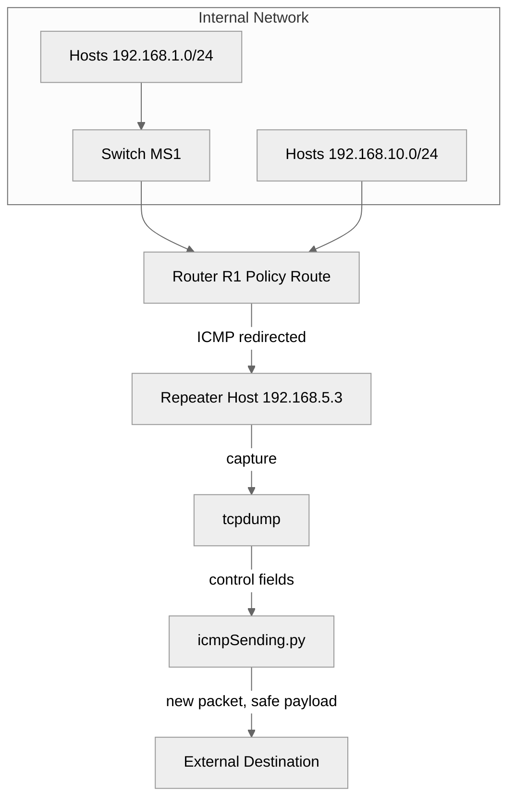

# Trusted Repeater

**Stops covert data exfiltration by regenerating outbound packets with known-safe payloads instead of inspecting them.**

 [](https://patents.google.com/patent/US12598158B2/)    

Trusted Repeater is a lab prototype of the packet regeneration method described in U.S. Patent No. 12,598,158 B2. Outbound ICMP echo traffic is diverted to a repeater host, which builds a brand-new packet with the same addresses, identifier, and sequence number but a payload known to be safe. Any data hidden inside the original payload is discarded by construction, without having to detect it first.

## Overview

The repository contains the network configuration and the scripts for an ICMP worked example of the patented method. A Cisco router uses policy-based routing to send ICMP from the internal subnets to a Linux repeater host. On that host, tcpdump captures each echo request and echo reply, and a Python script built on Scapy extracts the control fields and transmits a regenerated packet in place of the original.

- **Redirect without inline inspection:** a route map on router R1 diverts internal ICMP to the repeater host at `192.168.5.3`.
- **Regenerate, do not forward:** `icmpSending.py` builds a new echo request or echo reply from the captured control fields.
- **Known-safe payloads:** echo requests carry an empty payload; echo replies carry a timestamp plus the standard Linux ping byte pattern.

## Business Case

### The Problem

Once malware is inside a network, often delivered by phishing, it exfiltrates data through outbound protocols that firewalls routinely allow, such as ICMP, DNS, and HTTP. ICMP tunneling, for example, hides stolen data inside the payload of ordinary ping packets. Detection-based defenses (signatures and machine learning classifiers) miss novel channels, produce false negatives, and add per-packet latency.

### Who It Serves

- **Security teams in regulated or high-value environments:** finance, healthcare, government, defense contractors, and operational technology networks that must guarantee data cannot leave through covert channels.
- **Network security vendors:** firewall, secure access service edge, and network appliance vendors that could ship regeneration as a feature.
- **Managed security providers:** teams protecting many small networks with limited inspection budgets.

### The Outcome

Outbound traffic keeps working: pings are still answered, and destinations and identifiers are unchanged. Any hidden payload is destroyed because it is never copied into the regenerated packet, so protection does not depend on detection accuracy. The patent describes lower latency than classification-based approaches, and each regeneration event can also be logged for analytics.

## Patent

The method implemented in this repository is protected by [U.S. Patent No. 12,598,158 B2](https://patents.google.com/patent/US12598158B2/), with Karthik Shourya Kaligotla and Arvin Reddy Jakkamreddy as named inventors.

| Field | Detail |
|---|---|
| Patent | [US 12,598,158 B2](https://patents.google.com/patent/US12598158B2/) |
| Title | Systems and methods for securing network traffic |
| Inventors | Karthik Shourya Kaligotla, Arvin Reddy Jakkamreddy |
| Filed | April 22, 2024 (priority: provisional 63/460,710, April 20, 2023) |
| Granted | April 7, 2026 |
| Pre-grant publication | US 2024/0356895 A1 (October 24, 2024) |

**Claimed approach.** The system receives packets, filters for outbound packets from inside the network to outside, and redirects them to a server. The server extracts the packet control information, identifies the packet type from its protocol, and identifies a parameter such as purpose or format from that type. It then generates a second packet of the same type with the same control information and a payload known to be safe, built from that parameter, and transmits it toward the external destination. Independent claims cover the method, a system, and a computer-readable medium.

**Commercial application.**

- A regeneration module in next-generation firewalls and secure access service edge platforms.
- A standalone egress appliance for high-security or air-gap-adjacent networks.
- A data loss prevention complement that closes covert channels that detection misses.
- A managed-service offering for small networks.

**Relationship to this code.** This repository prototypes the ICMP case of claim 1 (echo request and echo reply), with router policy-based routing as the redirect, tcpdump as the capture, and Scapy as the generator. The patent text uses a switch for redirection; this lab uses router PBR. Other protocols, flow classification, type flagging, and selective bypass rules are not implemented.

**Patent notice.** No license under this patent is granted by this repository, expressly or by implication. For licensing inquiries, contact the author via [GitHub](https://github.com/risingOnIP).

## How It Works

Internal ICMP is policy-routed to the repeater host, captured as text, reduced to its control fields, and re-sent as a newly built packet.



1. **Redirect:** in `config/router-r1.conf`, ACL `matchICMP` and route map `icmpRedirect` on Gi0/1 and Gi0/2 set next hop `192.168.5.3` for ICMP from the internal subnets.
2. **Capture:** `run-icmpSending.sh` runs tcpdump on inbound ICMP echo requests and replies and pipes each text line to `icmpSending.py`.
3. **Extract:** `parse_tcpdump_fields()` reads the source, destination, echo type, identifier, and sequence number from the line.
4. **Identify:** the echo type selects an echo request (ICMP type 8) or an echo reply (ICMP type 0).
5. **Generate:** `build_packet()` creates a new IP and ICMP packet with the same control fields and a known-safe payload.
6. **Transmit:** `main()` sends the regenerated packet with Scapy; the original packet is not forwarded.
7. **Record:** a second tcpdump in `run-icmpSending.sh` writes `save.pcap`, and `packetCapture.sh` can log echo traffic as text.

## Tech Stack

| Layer | Technology | Purpose |
|---|---|---|
| Network | Cisco 2911 router, IOS 15.7 | Policy-based routing redirect to the repeater host |
| Network | Cisco Catalyst 3750 v2 switch | Access switching for the 192.168.1.0/24 hosts |
| Tooling | tcpdump 4.99 or later | Capture of ICMP echo traffic as text and pcap |
| Backend | Python 3 and Scapy 2.5 or later | Field extraction and packet regeneration |
| Tooling | Bash | Capture pipeline orchestration |
| Tooling | Python `unittest` | Offline tests of parsing and packet building |

## Getting Started

### Prerequisites

- Linux host with root access (tcpdump and raw packet sending require it).
- Python 3.8 or later.
- tcpdump 4.99 or later (its `-i any` output includes the interface and direction columns that the parser expects).
- For the full lab: a Cisco router that supports policy-based routing, configured as in `config/router-r1.conf`.

### Installation

1. Clone the repository.

   ```bash
   git clone https://github.com/risingOnIP/trustedRepeater.git
   cd trustedRepeater
   ```

2. Install the Python dependency for the interpreter that root uses.

   ```bash
   sudo python3 -m pip install -r requirements.txt
   ```

### Configuration

| Item | Required | Description |
|---|---|---|
| `config/router-r1.conf` | Yes, for the lab | Sample router configuration with the ACL, route map, and PBR bindings |
| `config/switch-ms1.conf` | No | Sample access switch configuration for the 192.168.1.0/24 hosts |
| IP forwarding on the repeater host | Yes | Disable it (`sysctl -w net.ipv4.ip_forward=0`) so original packets are dropped and only regenerated copies leave |
| `TIMESTAMP_OFFSET_SECONDS` in `icmpSending.py` | No | Offset that aligns the reply timestamp with the originating host's clock; specific to the original lab |

### Usage

Run the offline tests. They feed sample tcpdump lines to the parser and packet builder and send nothing.

```bash
python3 -m unittest discover -s tests -v
```

Start regeneration on the repeater host.

```bash
sudo bash run-icmpSending.sh
```

Optionally log echo traffic as text to `packetsStored.txt`.

```bash
sudo bash packetCapture.sh
```

While `run-icmpSending.sh` runs, each captured echo packet is printed with its type, source, destination, identifier, and sequence number, a regenerated packet is sent, and the capture is saved to `save.pcap`.

## Project Structure

```text
trustedRepeater/
├── config/
│   ├── router-r1.conf         # router R1 with PBR redirect
│   └── switch-ms1.conf        # access switch MS1
├── tests/
│   └── test_icmp_sending.py   # offline parsing and building tests
├── icmpSending.py             # parses fields, builds and sends packets
├── run-icmpSending.sh         # capture pipeline into the regenerator
├── packetCapture.sh           # text log of ICMP echo traffic
├── requirements.txt
├── LICENSE
├── NOTICE
└── README.md
```

## Scope and Limitations

- This is a lab prototype. `icmpSending.py` and `run-icmpSending.sh` were repaired from the published version, which could not run, and the repaired code is verified by offline unit tests only. It has not been re-tested on live hardware since the repair.
- Only ICMP echo requests and echo replies are regenerated. Other ICMP types and other protocols are not handled.
- Field positions assume the tcpdump 4.99 `-i any` line layout. Lines in a different layout are reported and skipped rather than regenerated.
- Regenerated echo requests carry an empty payload, so their size differs from the original request.
- The reply timestamp uses a fixed clock offset (`TIMESTAMP_OFFSET_SECONDS`) taken from the original lab setup.
- The pipeline starts one Python process per captured packet, which suits a lab but not production traffic volumes.
- The device configurations are samples: passwords, the router serial number, and the switch certificate are redacted.
- The script keeps its original file name, `icmpSending.py`.

## Roadmap

- [ ] Validate the repaired pipeline end to end on the lab hardware.
- [ ] Replace the per-packet process launch with one long-running capture and regeneration loop.
- [ ] Extend regeneration to other outbound protocols such as DNS and HTTP.
- [ ] Add flow classification and selective bypass rules as described in the dependent claims.
- [ ] Log regeneration events for analytics.
- [ ] Rename `icmpSending.py` to a snake_case module name and update the run script.

## License

Copyright (c) 2024 Karthik Kaligotla. All rights reserved. The source is published for review and evaluation. See [LICENSE](LICENSE) and [NOTICE](NOTICE). The underlying method is protected by U.S. Patent No. 12,598,158 B2; no patent license is granted.

## Author

Developed by [Karthik Kaligotla](https://github.com/risingOnIP), named inventor on U.S. Patents [12,445,488 B2](https://patents.google.com/patent/US12445488B2/) and [12,598,158 B2](https://patents.google.com/patent/US12598158B2/).
